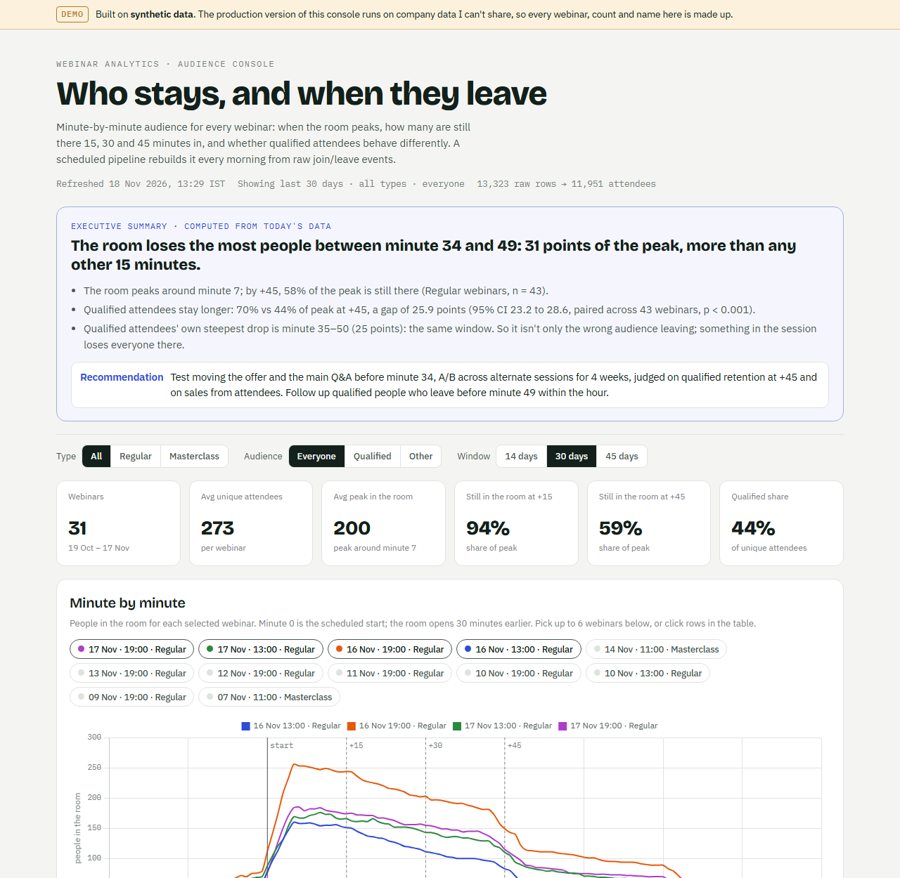
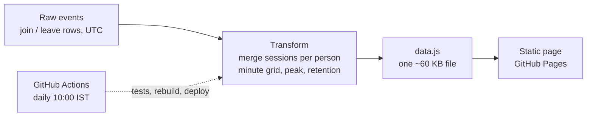

<div align="center">

# Webinar Audience Console

**Who stays, and when they leave: minute-by-minute webinar retention, rebuilt every morning by a scheduled pipeline.**

[](https://nikhilveerwani.github.io/webinar-audience-console/)
[](https://github.com/nikhilveerwani/webinar-audience-console/actions/workflows/refresh.yml)


<a href="https://nikhilveerwani.github.io/webinar-audience-console/"></a>

</div>

> **Demo with synthetic data.** I built and run the production version of this console on company data I can't share. This repo is a clean-room rebuild: fresh code, made-up webinars and attendees, and the same analytical rules. Every number you see here is synthetic.

## Executive summary

- **The room loses most people in one 15-minute window (about minute 34–49): around 30 points of the peak.**
- **Qualified attendees stay longer:** about 70% vs 44% of peak at +45, a 26-point gap (95% CI 23–29, paired across 43 webinars, p < 0.001).
- **But qualified people's steepest drop is in the same window**, so it isn't just the wrong audience leaving. Something in the session at that point loses everyone.
- **Recommendation:** move the offer and the main Q&A before the drop in alternate sessions for 4 weeks, and judge on qualified retention *and* attendee sales. Full reasoning in the **[decision memo](docs/decision_memo.md)**.

*The live page recomputes this summary from each morning's data.*

## The problem

A team runs a webinar almost every day and treats it as its main top-of-funnel event. Attendance alone tells them very little. The questions that matter are:

- **When does the room peak, and how fast does it empty?** Is the drop at minute 20 or at the pitch?
- **Do the people we care about (qualified attendees) stay longer than everyone else?**
- **Is a given session better or worse than the usual pattern**, so the presenter and the follow-up team know what to change?

The raw export from the video platform can't answer these directly. It has one row per join/leave *session*, not per person. People rejoin after a dropped connection, some join from two devices, half the room arrives before the scheduled start, and every timestamp is in UTC.

## What the console shows

| View | Question it answers |
|---|---|
| **KPI row** | How big the average room is, when it peaks, and how much of the peak is left at +15 and +45 minutes |
| **Minute by minute** | The full audience curve for up to 6 webinars side by side, with markers at start, +15, +30 and +45 |
| **Day on day** | Unique attendees per day, split into Qualified and Other |
| **Where the room thins out** | Retention curve for Qualified vs Other: are the right people staying? |
| **Every webinar** | A sortable table (peak, peak minute, +15/+30/+45, average watch time). Click a row to chart it. |
| **Data checks** | Rows read, attendees after merging, rejoin rows collapsed: reconciled on every run |

Filters: webinar type, audience segment, and a 14, 30 or 45-day window.

## How it works



1. **`pipeline/generate_raw_events.py`** writes realistic, messy raw data: early arrivals, rejoins, second devices, and UTC timestamps. Each day's data is seeded from its date, so history stays stable as the window rolls forward.
2. **`pipeline/transform.py`** applies the rules below and writes one compact data file.
3. **`site/index.html`** is a single static page (vanilla JS and Chart.js). It needs no server and no database, and it loads instantly.
4. **`.github/workflows/refresh.yml`** runs the unit tests, regenerates the data, rebuilds and deploys to GitHub Pages every morning at 10:00 IST.
5. **`sql/minute_occupancy.sql`** is the same transform written for BigQuery, for when the raw events live in a warehouse. It uses gaps-and-islands to merge sessions, `GENERATE_ARRAY` for the minute grid, and peak and retention in one pass.

## The rules (and why)

- **Minute 0 is the scheduled start, not when the room opened.** Two webinars can only be compared on the same clock.
- **Each person counts once per minute.** Sessions are merged per attendee before counting, so a dropped connection or a second laptop never inflates the room. The Data checks panel shows how many rows this collapsed.
- **Retention at +N = people in the room at minute N ÷ peak.** Peak is measured from minute 0, so early arrivals waiting in the lobby can't set it.
- **Timestamps are converted from UTC to IST once, in the transform**, never in the page.

The tricky parts (overlapping devices, sub-minute rejoins, clipping to the window) are covered by unit tests in `tests/`.

## Statistical checks

- **Qualified vs Other** is a *paired* comparison: the gap is measured inside each webinar, then averaged with a 95% interval. That removes session-to-session differences (topic, day, audience size) from the comparison.
- **The drop window** is found on curves normalised to each webinar's own peak before averaging, so one big Masterclass can't set the pattern.

## Limitations, and what I'd do next

- **Leaving isn't always losing.** Some leave because they've decided to buy. Next: join each attendee's leave minute to purchases to split "lost" from "done".
- **Correlation, not cause.** The drop lines up with a point in the session; only an A/B test shows what fixes it.
- **Minute resolution** is right for 15-minute windows, too coarse for second-level edits.
- **"Qualified" is fixed at registration.** In-session signals (questions, polls) would make a better segment.

## Documents

- **[Decision memo](docs/decision_memo.md):** the decision, evidence, options, recommendation, and what would change it
- **[Data dictionary](docs/data_dictionary.md):** every column, metric definition and statistical check

## Run it locally

```bash
python pipeline/generate_raw_events.py --out data/raw --days 45
python pipeline/transform.py --raw data/raw --out site/data.js
python -m unittest discover -s tests
# then open site/index.html in a browser
```

It uses only the Python standard library, so there's nothing to install.

---

<sub>Built by <a href="https://nikhilveerwani.github.io/">Nikhil Veerwani</a> · Analytics, BI &amp; Growth · All data in this repository is synthetic.</sub>
